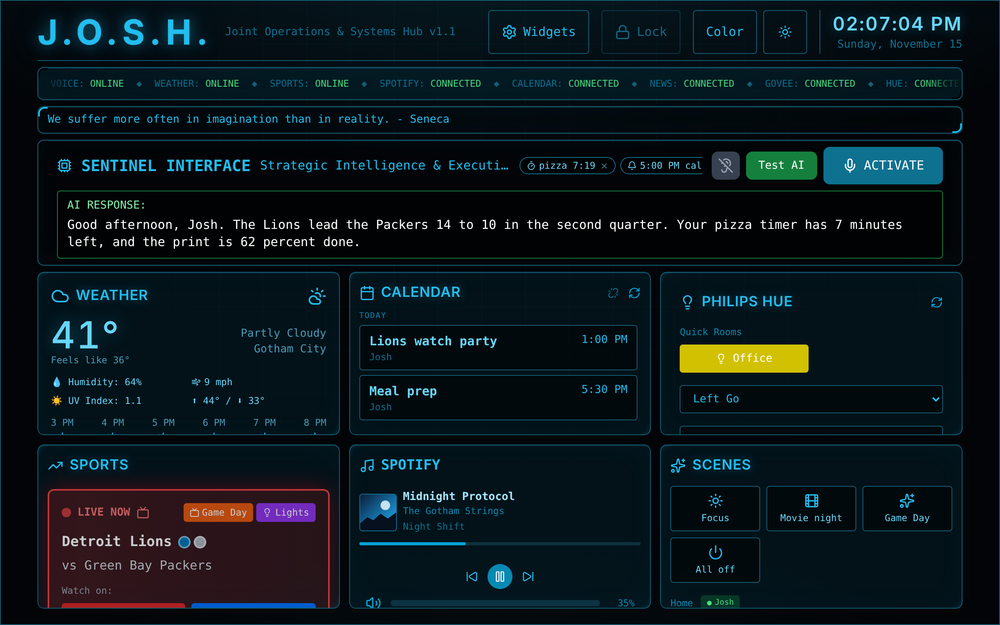
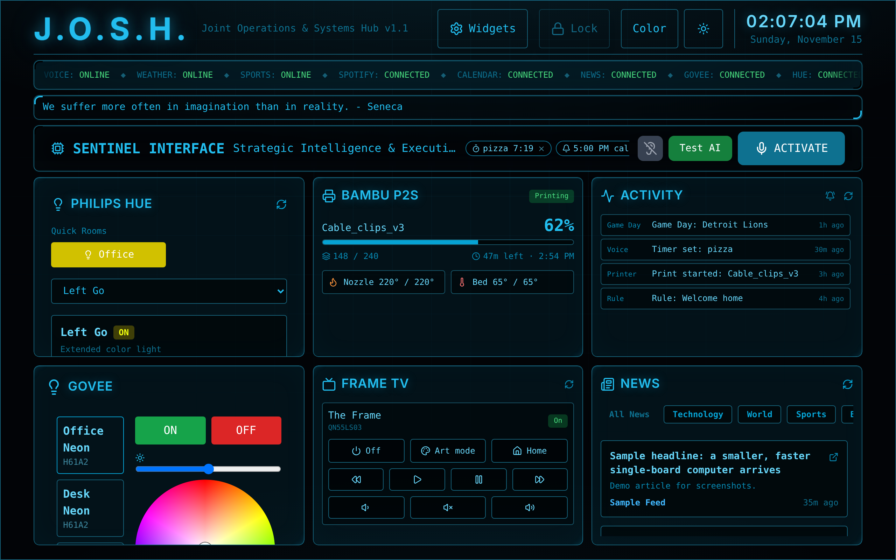
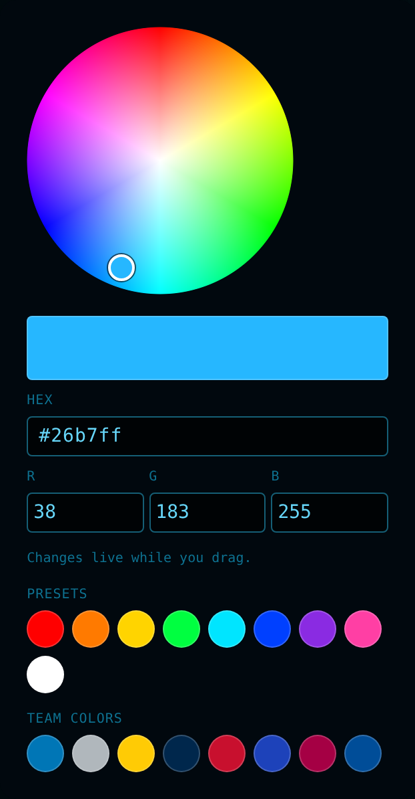
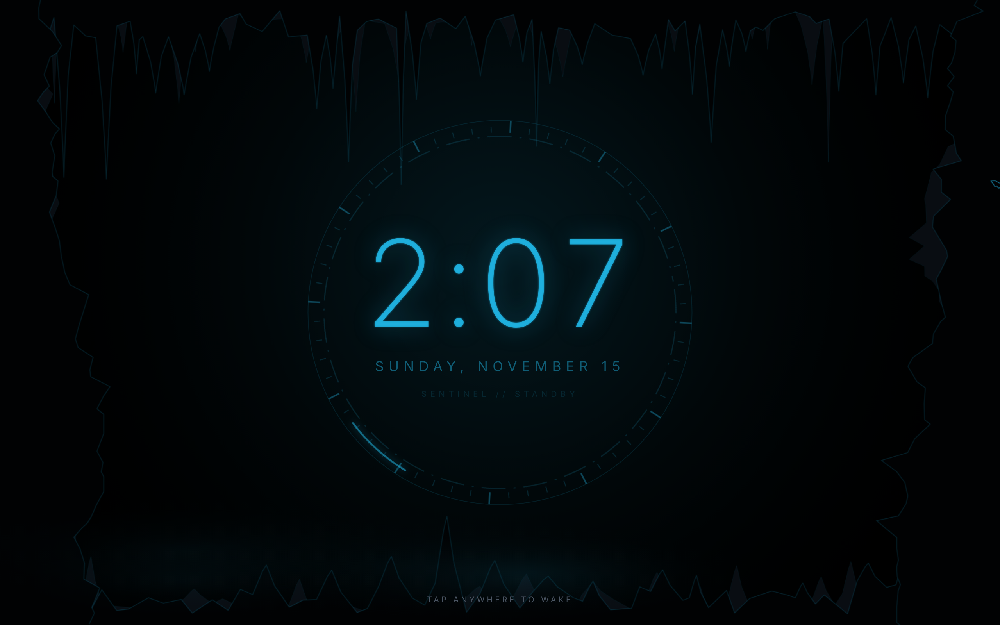
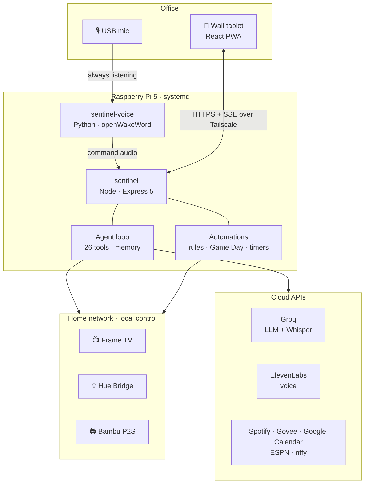

# J.O.S.H. — Joint Operations & Systems Hub

**A Batcave-themed smart home command center and voice AI agent, running 24/7 on a Raspberry Pi 5 behind a wall-mounted tablet.**

Say *"Alfred, turn off the lights and play Discover Weekly on The Frame"* and it happens: the lights go dark, the TV wakes, Spotify opens on it, and the playlist starts.


🎥 **[Video demo](https://www.linkedin.com/feed/update/urn:li:activity:7437486243988361216/)**



| | |
|---|---|
| 🧠 **AI agent** | Tool-calling loop over **26 tools**: lights, TV, music, calendar, sports, timers, live web search, long-term memory |
| 🎙️ **Hands-free voice** | On-device wake word ("Alfred") on the Pi, cloud transcription, spoken replies |
| 🏠 **Local-first control** | Samsung Frame TV and Philips Hue driven directly over the home network, no vendor cloud |
| ⚙️ **Automation engine** | Scenes, rules (time, sunset, presence), Game Day mode, morning briefings |
| 🧪 **214 automated tests** | Node (`node:test`), React (Vitest + Testing Library), Python (`unittest`) |
| 🚀 **One-command deploy** | Build → rsync → systemd on the Pi, health-checked, served over Tailscale HTTPS as a PWA |

---

## Meet Alfred

Alfred is the voice of the system: an Alfred Pennyworth-style assistant that **acts**, not just chats.

| Ask | What happens |
|---|---|
| "Alfred, turn off the lights" | Every Govee strip and Hue lamp off. Answered instantly, no AI call needed |
| "Make them blue" | Follow-up: Alfred remembers the last few minutes of conversation |
| "Play Discover Weekly on The Frame" | Wakes the TV, opens Spotify on it, waits for it to register as a device, starts the playlist |
| "I'm in a Tyler, the Creator mood" | Plays the artist, pulls the album art, extracts its dominant color, sets the room to match |
| "What games are on today?" | Real ESPN data for the teams I follow: start times, networks, live scores |
| "Set a 10 minute pasta timer" / "Remind me at 5 to call Mom" | Countdown chip on screen; announced out loud and pushed to my phone when due |
| "Brief me" | Weather, today's calendar, games, and reminders in one short rundown |
| "Open YouTube on the TV" | Local Frame TV control: power, art mode, apps, volume, playback |
| "Who won the Michigan game?" | Live web answer via Groq's built-in browser search, read back in a couple of sentences |
| "Remember I like the lights at 40% after 9" | Long-term memory: saved, and used in every answer from then on ("forget that" works too) |
| "Add dinner Friday at 7" | Creates the Google Calendar event ("undo that" removes it) |
| *(right after he answers)* "and make them warmer" | Follow-up listening: the Pi mic stays open a few seconds, no wake word needed |

He also speaks up unprompted: a briefing the first time the panel sees me in the morning, a welcome when I get home, live game alerts ("Touchdown Lions! Lions 21, Packers 10."), weather heads-ups ("rain starting around 4"), Game Day kickoffs, and finished 3D prints.

---

## Screenshots

| Devices: lights, printer, TV, activity | Color studio | Idle "Batcave" screen |
|---|---|---|
|  |  |  |

<sub>Rendered from the real app with sample data (`npm run screenshots`): no real devices, accounts, calendar or location.</sub>

---

## Hardware

| Device | Role | How Sentinel talks to it |
|---|---|---|
| **Raspberry Pi 5** (2 GB, active cooler, HighPi Pro 5S case) | Always-on host for both services (`sentinel`, `sentinel-voice`) | systemd; served to the tailnet with Tailscale Serve (HTTPS) |
| **Samsung Galaxy Tab S7+**, wall-mounted | The panel: installed PWA; front camera for face lock and wake-on-presence | HTTPS + Server-Sent Events |
| **USB microphone** (UM02) on the Pi | Always-on ears for the "Alfred" wake word | ALSA → Python (sounddevice) |
| **Samsung The Frame** TV (2024) | Game Day, apps, art mode, Spotify playback | Local WebSocket remote + art channel, REST, Wake-on-LAN, UPnP |
| **Philips Hue Bridge** + two **Hue Go** lamps | Accent lighting, team colors, color studio | Local Hue REST API (CIE xy colors) |
| **Govee** LED neon strips | Room lighting, team colors, album-art sync | Govee cloud API (rate-limited, sequenced) |
| **Bambu Lab P2S** 3D printer | Print progress, spoken "print finished" | Local MQTT over TLS |
| **Phone** on Tailscale | Presence: home / away, welcome-home briefing | `tailscale ping` path detection |
| *Optional:* USB speaker on the Pi | Tablet-free mode: replies spoken by the Pi | `mpg123` |

The Pi runs headless on Wi-Fi; everything is deployed from a laptop with one command.

---

## Architecture



**Request path:** wake word on the Pi → endpointing → Groq Whisper → instant-command matcher or the LLM agent loop → device APIs → reply text → ElevenLabs voice on the tablet. If no tablet is listening, the Pi runs the command itself.

---

## Engineering highlights

The interesting parts weren't the widgets. They were the problems behind them.

**An agent you can trust with facts.**
The LLM once listed three "games on today" that didn't exist. Sports, calendar, weather and news now come only from tools that return real, date-filtered data. The system prompt forbids stating anything that changes over time unless a tool returned it, and tools return explicit "don't guess" errors when a source is down. A whole-sentence matcher handles everyday commands with no LLM call at all, so it's faster, free and immune to rate limits.

**Fitting 26 tools into a free tier.**
Every tool definition rides along on every agent step: about 2.9K tokens, against Groq's 8K-tokens-per-minute free tier. A tool router sends only the groups a request needs, keyed on the new message *and* the previous one, so follow-ups like "make them blue" keep the light tools. Nothing matched means every tool, so no capability is ever unreachable. Everyday commands skip the model entirely.

**Graceful degradation on free tiers.**
Groq's free tier allows 8K tokens per minute per model, and a single agent step carries about 2.4K tokens of prompt and tools. On a 429, the backend honors a short `retry-after`; otherwise it fails over to a sibling model with its own budget, instead of telling the user "AI unavailable."

**Local control after a vendor paywall.**
When SmartThings put its API behind a paid plan, I replaced it with direct LAN control of the Frame TV:
- the WebSocket remote and art-mode channels, with token pairing;
- Wake-on-LAN;
- UPnP mute;
- app launches confirmed through the TV's REST API, with fallback launch strategies per app.

An "awaiting approval" state also stops the TV from spamming permission prompts.

**A hands-free voice pipeline.**
A Python service on the Pi runs an on-device wake-word model and records until the speaker pauses. It measures the room's noise floor from a low percentile of recent audio. An early version measured the wake word itself as "noise" and ignored every command. The backend relays each command over Server-Sent Events to exactly one tablet, with per-command IDs so it never runs twice. The listener authenticates with a shared token, because Tailscale Serve makes the tablet's requests look like localhost too.

**Defensive integrations.**
- Govee and the Hue bridge both report failures *inside HTTP 200 responses*. Both are parsed, so "Going dark" is never said over lights that stayed on.
- Govee commands are sequenced and retried to stay under its rate limit.
- Each widget sits behind its own error boundary.
- Rules record the triggers they missed while the host was down.
- A heartbeat sends crash and recovery alerts to my phone.

**Presence without an app.**
"Home" is decided by `tailscale ping`: a direct private-LAN path to my phone means I'm here. A grace period keeps a brief Wi-Fi drop from counting as leaving.

**Tests that remember bugs.**
214 automated tests, many named after the real failure they lock down: "Android repeated every word twice", "two panels open: the command runs on ONE", "Hacker News boilerplate is not shown as a summary".

---

## Features

**Voice & AI**
- Hands-free wake word on the Pi; tap-to-talk and in-browser wake word on the tablet
- Agent loop with tool calling, short-term memory, and instant commands
- ElevenLabs voice, with units spoken naturally ("54 degrees", not "54 deg F")
- Timers, reminders, briefings and spoken announcements
- Live web answers, long-term memory, calendar event creation, follow-up listening
- Proactive alerts: live game scores/halftime/finals, rain/snow/freeze heads-ups

**Lights**
- Govee strips and Philips Hue lamps through one reliable path
- Full-RGB color studio: drag wheel, hex and R/G/B entry, team-color presets, recent colors. Hue uses Philips' own CIE xy conversion, live while dragging

**Music & TV**
- Spotify playback anywhere: playlists by name, saved shortcuts for Spotify-made playlists, a chosen device, one-tap resume on the panel
- Frame TV: power, art mode, apps, volume, playback, Wake-on-LAN

**Automation**
- Scenes and rules triggered by time, sunset or presence, with an activity log
- **Game Day:** when a team I follow goes live, the lights switch to team colors, and the TV wakes muted on the right streaming app for that game's broadcast network
- ntfy push notifications: rule failures, presence, prints, reminders, uptime

**Panel**
- Two-row horizontal widget grid that fits the screen exactly, with drag-to-reorder
- Widgets: weather, 7-day calendar, sports, news, Spotify, Govee, Hue, Frame TV, scenes, activity, 3D printer
- Face-recognition lock, idle "Batcave" screen with camera wake, light/dark mode and themes
- Installable PWA, served over HTTPS on a private tailnet

---

## Tech stack

| Layer | Technology |
|---|---|
| Frontend | React 19, Vite 7, Tailwind CSS, PWA, face-api |
| Backend | Node.js 24, Express 5, Server-Sent Events, `ws`, MQTT, Sharp |
| AI | Groq (`gpt-oss-120b` / `gpt-oss-20b` fallback) with tool use; Groq Whisper (speech-to-text); ElevenLabs (TTS) |
| Voice on the Pi | Python, openWakeWord (ONNX Runtime), sounddevice, systemd |
| Devices | Samsung Frame TV (local WebSocket/REST/UPnP/WoL), Philips Hue (local), Govee, Bambu P2S (MQTT), Spotify |
| Data | ESPN, Google Calendar (server-side OAuth), Open-Meteo, RSS |
| Infra | Raspberry Pi 5, Tailscale (HTTPS + presence), ntfy, rsync + systemd deploy |
| Testing | `node:test`, Vitest + Testing Library, Python `unittest`, Playwright layout checks |

---

## Project structure

```
├── src/                      React panel
│   ├── components/           widgets, color studio, idle screen, face lock
│   └── utils/                speech, wake word, Pi voice events, color math
├── backend/
│   ├── routes/               HTTP API (agent chat, voice relay, devices, auth...)
│   ├── lib/
│   │   ├── sentinel/         agent: tools, executor, prompt, memory, instant commands
│   │   ├── frameTv.js        local Samsung Frame TV protocol
│   │   ├── devices.js        Govee + Hue (+ TV) with failure handling
│   │   ├── rules.js scenes.js gameDay.js timers.js briefing.js presence.js
│   │   └── sports.js calendar.js spotifyPlay.js notify.js bambu.js
│   └── test/                 node:test suites
├── docs/screenshots/         README images (scripts/screenshots.cjs, sample data)
├── voice/                    Pi wake-word listener (Python) + wake-word model
├── deploy/ scripts/          systemd units, bootstrap, one-command deploy
└── docs/                     Pi setup, voice pipeline
```

---

## Running it

**Develop locally**

```bash
git clone https://github.com/JCUN23/J.O.S.H..git && cd J.O.S.H.
npm install && (cd backend && npm install)
cp backend/.env.example backend/.env      # add your keys; every integration is optional

(cd backend && npm start)                 # API on :3001
npm run dev                               # panel on :5173
```

**Deploy to a Raspberry Pi:** see [`docs/pi-setup.md`](docs/pi-setup.md) for first-time setup, then:

```bash
npm run deploy    # build, sync, install, restart, health-check (also installs the voice service)
```

**Hands-free voice:** see [`docs/voice-on-pi.md`](docs/voice-on-pi.md).

**Screenshots** (sample data, needs Playwright)

```bash
npm run screenshots                       # writes docs/screenshots/*.png
```

**Tests**

```bash
npm test                                  # React (Vitest)
(cd backend && npm test)                  # Node
(cd voice && python3 -m unittest)         # Python listener
```

Configuration lives in `backend/.env` (see [`.env.example`](backend/.env.example)). Secrets, OAuth tokens and the home location never live in the repo.

---

## Roadmap

- [ ] Custom-trained wake word, plus a speaker on the Pi for a fully tablet-free mode
- [ ] Multi-room: more panels and TVs, each command routed to the nearest one
- [ ] Calendar writes ("add dinner Friday at 7")

---

## Built with

Designed and built by [@JCUN23](https://github.com/JCUN23), pair-programmed with [Claude Code](https://claude.com/claude-code).

Personal project; not licensed for redistribution.
