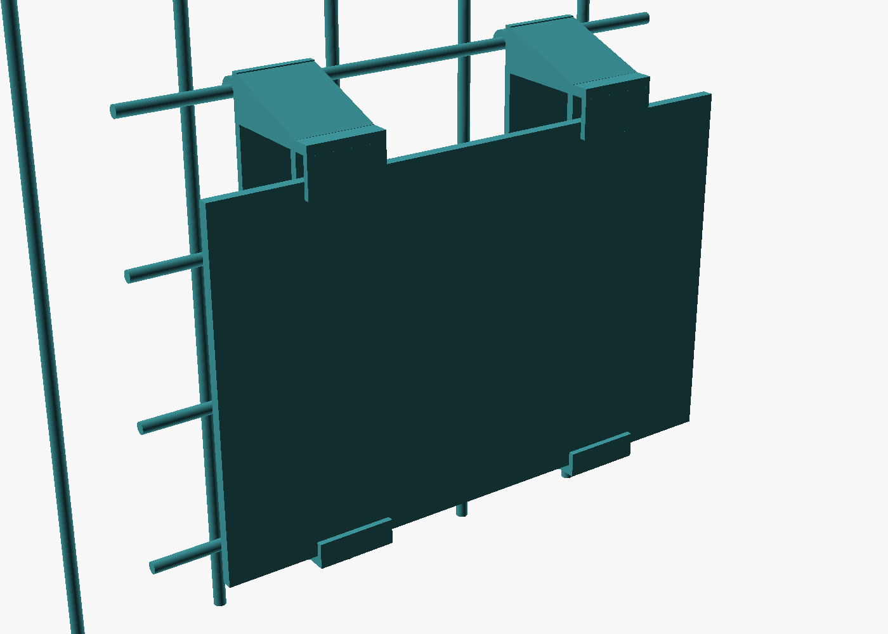
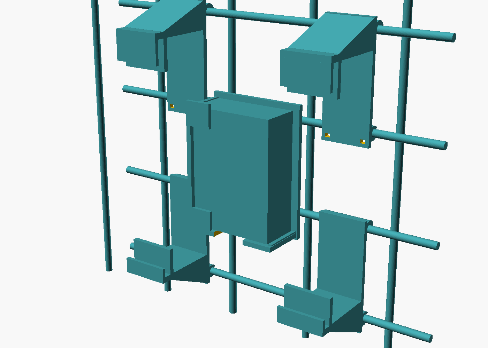

# Sentinel wall mount (gridwall)

Holds the Raspberry Pi 5 and a **removable** Galaxy Tab S7+ on a Uline gridwall
(1/4" wire, 3" grid). Parametric OpenSCAD source: `sentinel_mount.scad`.

 

## How it works

- Every part hangs on **two horizontal wires one square apart**: a **J-hook** over
  the upper wire carries the load, a **snap clip** on the lower wire stops it lifting
  off. Zip-tie slots beside the snap are there if you want it permanent.
- Hooks sit **mid-cell**, clear of the vertical wires.
- The tablet is held only on its **long edges**, so both short ends (USB-C) are open.
- The Pi stands upright in the middle column, hidden behind the tablet, USB end up,
  SD-card end down, port side open.

## 1. Check three things on your wall first

| Check | Why | Default |
|---|---|---|
| Wire diameter (calipers) | hook and snap fit | `wire_d = 6.35` |
| Space **behind** the horizontal wires | the J-hook tab reaches about 7 mm behind the wire centre | needs ≥ 7 mm |
| Which layer is in front, horizontal or vertical wires | the Pi tray already stands off to clear either; hooks need the horizontal wire reachable | handled |

## 2. Print the fit test first (about 10 minutes)

`fit_test.stl` is just a hook and a snap. Hang it on the wall:
- The **hook** should drop over a wire freely, with little play.
- The **snap** should click onto the wire below with a firm push and not rattle.

Tune `wire_clear` (hook) and `snap_grip` (snap: lower is tighter) in the `.scad`
and re-export until it's right, **then** print the real parts.

## 3. Print

| Part | Qty | Orientation | Supports |
|---|---|---|---|
| `bottom_shelf.stl` | 2 | **lying on a side face** (the 40 mm width becomes print height) | none |
| `top_cap.stl` | 2 | lying on a side face | none |
| `pi_tray.stl` | 1 | lying on a side face | tree supports |
| `fit_test.stl` | 1 | lying on a side face | none |

Printing on the side puts the whole hook profile in every layer, which is the
strong direction for a hook (layers can't peel apart under load).

Bambu P2S suggestions: **PETG**, 0.2 mm layers, **4 walls**, 40 % gyroid infill.
PETG over PLA: the Pi runs warm and the parts are under constant load (PLA creeps).

## 4. Hang it

Grid columns below are counted from the middle one (0) where the Pi goes.

1. **Bottom shelves:** columns −1 and +1, hook on wire 1, snap on wire 0.
2. **Top caps:** same columns, hook on wire 3, snap on wire 2.
3. **Pi tray:** column 0, hook on wire 2, snap on wire 1. Slide the Pi in from
   the open (port) side until it stops.

To hang a part: hook the top over its wire, swing the bottom in, push until the
snap clicks.

## 5. The tablet

- **In:** slide the top edge up into the caps, lower the bottom into the shelves.
- **Out:** push the tablet **up** (about 1 cm, into the caps), swing the bottom
  toward you past the short bottom lip, then lower it out of the caps.

No flexing parts, so nothing wears out.

## Changing it

All the numbers that matter are at the top of `sentinel_mount.scad`:
tablet size (`tab_w/h/t`, e.g. for a case), `travel` / `bottom_lip` / `top_lip`
(lift-out geometry; the file prints a check that they still work), Pi case size,
`port_side`, and `air_gap` behind the tablet.

Export a part:

```bash
openscad -D 'part="bottom_shelf"' -o bottom_shelf.stl sentinel_mount.scad
```
